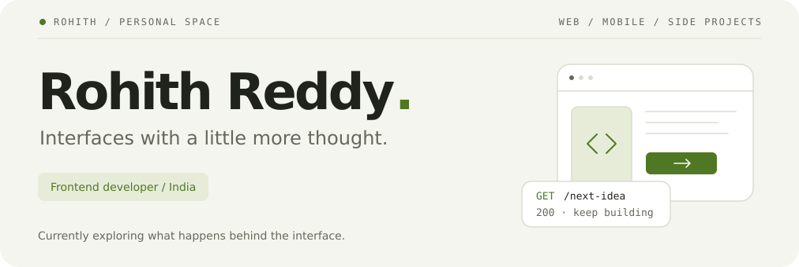

<picture>
  <source media="(prefers-color-scheme: dark)" srcset="./assets/header-dark.svg" />
  <source media="(prefers-color-scheme: light)" srcset="./assets/header-light.svg" />
  
</picture>

  <a href="https://rohith-reddy.vercel.app/"><b>Portfolio</b></a>
  &nbsp; / &nbsp;
  <a href="https://www.linkedin.com/in/rohith-reddy45/">LinkedIn</a>
  &nbsp; / &nbsp;
  <a href="mailto:samreddyrohith@gmail.com">Email</a>
  &nbsp; / &nbsp;
  <a href="https://github.com/RohithReddy-45?tab=repositories">All projects</a>

## A little context

I build web and mobile interfaces with React, Next.js, and React Native. I like projects that make something easier to use, whether that is finding a course or saving an image from a webpage.

Right now, I’m spending more time on the backend: APIs, databases, and the pieces that turn an interface into a working product.

## A few things I’ve built

<table>
  <tr>
    <td width="50%" valign="top">
      <h3><a href="https://github.com/RohithReddy-45/byte-tutorials">01 / Byte Tutorials</a></h3>
      
A place to turn YouTube courses into structured learning, with progress tracking, timestamped notes, and a personal watch list.

      
<code>Next.js</code> <code>TypeScript</code> <code>Drizzle</code> <code>Turso</code>

      <a href="https://byte-tutorials.vercel.app/">Explore the app ↗</a>
    </td>
    <td width="50%" valign="top">
      <h3><a href="https://github.com/RohithReddy-45/vscode-portfolio">02 / VS Code Portfolio</a></h3>
      
A portfolio built around a familiar workspace: the editor. Made with React Native, Expo, and NativeWind.

      
<code>React Native</code> <code>Expo</code> <code>NativeWind</code>

      <a href="https://github.com/RohithReddy-45/vscode-portfolio">Open the source ↗</a>
    </td>
  </tr>
  <tr>
    <td width="50%" valign="top">
      <h3><a href="https://github.com/RohithReddy-45/drag-drop-image-extension">03 / Drag &amp; Drop Images</a></h3>
      
A Chrome extension that saves images from webpages with a drag and drop. A small tool for a repeated task.

      
<code>JavaScript</code> <code>Browser extension</code>

      <a href="https://github.com/RohithReddy-45/drag-drop-image-extension">Open the source ↗</a>
    </td>
    <td width="50%" valign="top">
      <h3><a href="https://github.com/RohithReddy-45/stepinstyle">04 / Step in Style</a></h3>
      
A shoe store built with the MERN stack, bringing the storefront and backend together in one project.

      
<code>React</code> <code>Node.js</code> <code>Express</code> <code>MongoDB</code>

      <a href="https://step-in-style.netlify.app/">Visit the store ↗</a>
    </td>
  </tr>
</table>

## What I work with

| Area | Tools |
| :--- | :--- |
| Web interfaces | React · Next.js · TypeScript · JavaScript · Tailwind CSS |
| Mobile | React Native · Expo |
| Backend &amp; data | Node.js · Express · MongoDB · MySQL |
| Also in the toolkit | Redux · Styled Components · Python · Git · Figma |

## Recent activity

[View my commit history ↗](https://commit-history.com/RohithReddy-45)

<picture>
  <source media="(prefers-color-scheme: dark)" srcset="https://commit-history.com/embed/RohithReddy-45?theme=dark" />
  
</picture>

  Have something interesting to build? <a href="mailto:samreddyrohith@gmail.com">Let’s talk.</a>

